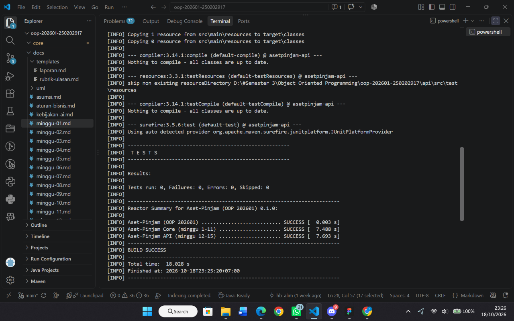

# Catatan Minggu-01: Paradigma Pemograman dan Setup

## Yang saya kerjakan
Pada minggu pertama, saya mempelajari struktur repository dan menyiapkan tools yang diperlukan untuk mengerjakan proyek Aset-Pinjam. Saya mengerjakan tiga file Java, yaitu `HelloProsedural.java`, `HelloOOP.java`, dan `HelloFungsional.java`, dengan membuat program sapaan menggunakan tiga paradigma pemrograman yang berbeda. Setelah itu, saya menjalankan program untuk melihat hasilnya dan melakukan pengujian menggunakan skrip `uji.ps1`.

## Keputusan desain
Saya menggunakan kalimat sapaan yang sama agar perbedaan ketiga paradigma lebih mudah dipahami. Saya menggunakan fungsi statis pada prosedural, atribut dan konstruktor pada OOP, serta lambda expression pada fungsional. Saya juga menggunakan operator `+` untuk menggabungkan teks karena lebih mudah saya pahami.

## Kendala
Saya masih kesulitan memahami penggunaan lambda di Java dan langkah-langkah pengerjaan tugas. Saya mengatasinya dengan membaca contoh kode, meminta bantuan AI, dan bertanya kepada teman. Saya juga sempat mengalami kendala Execution Policy saat menjalankan `uji.ps1`, tetapi berhasil mengatasinya dengan `Set-ExecutionPolicy -Scope CurrentUser RemoteSigned`

## Penggunaan AI
- Alat yang dipakai: ChatGPT
- Bagian yang dibantu AI: Memahami instruksi tugas, menjelaskan kode, dan memeriksa kesalahan penulisan.
- Prompt utama: "Jelaskan tugas Minggu-01 beserta langkah pengerjaannya"
- Yang saya ubah atau tolak dari saran AI, dan alasannya: Saya menyesuaikan kalimat sapaan agar sesuai dengan ketentuan tugas.
- Satu hal yang saya pahami lebih baik sekarang: Perbedaan paradigma prosedural, OOP, dan fungsional dalam Java.

## Kelebihan dan Kekurangan
- Prosedural: Mudah dipahami, tetapi pengelolaan fungsi bisa lebih sulit saat program membesar.
- OOP: Kode lebih terstruktur, tetapi perlu memahami class dan objek.
- Fungsional: Lambda membuat kode lebih ringkas, tetapi perlu dibiasakan agar mudah dipahami.

## Dokumentasi Pengerjaan
