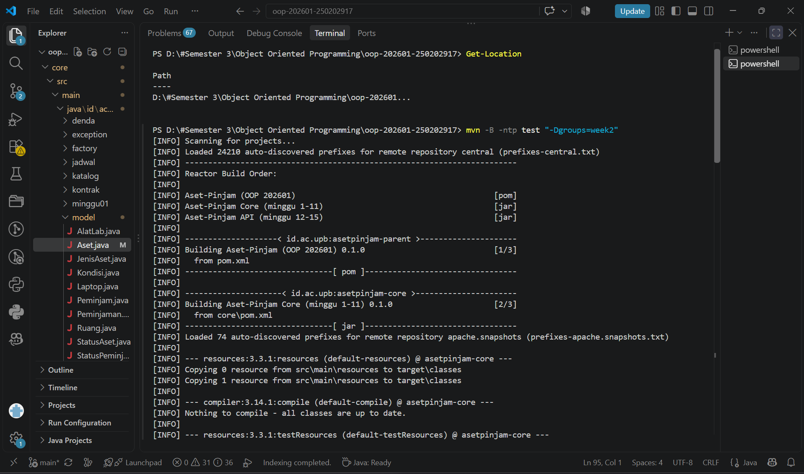

# Catatan Minggu-02: Class, Object, dan Encapsulation

## Yang saya kerjakan
Saya melengkapi class `Aset.java` dengan atribut `private`, konstruktor, getter, dan setter. Saya juga menambahkan validasi agar kode dan nama tidak kosong serta status dan kondisi tidak bernilai `null`. Setelah selesai, saya menguji kode menggunakan Maven dan hasilnya berhasil.

## Keputusan desain
Saya menggunakan `private` agar atribut tidak dapat diubah secara langsung dari luar class. Status awal ditetapkan `TERSEDIA` dan kondisi awal `BAIK`. Saya tidak membuat setter untuk `kode` karena kode digunakan sebagai identitas aset.

## Kendala
Saat menjalankan `uji.ps1`, tes yang berjalan masih Minggu 1. Saya mengatasinya dengan menjalankan perintah Maven khusus Minggu 2 melalui terminal VS Code, yaitu `mvn -B -ntp test "-Dgroups=week2"`. Hasil pengujian berhasil.

## Penggunaan AI
- **Alat yang dipakai:** ChatGPT.
- **Bagian yang dibantu AI:** Konstruktor, getter, setter, dan validasi pada `Aset.java`.
- **Prompt utama:** Membantu melengkapi TODO Minggu 2 pada class `Aset.java` sesuai ketentuan.
- **Yang saya ubah atau tolak dari saran AI, dan alasannya:** Saya mempertahankan method Minggu 3, 4, dan 5 sebagai TODO karena belum termasuk tugas minggu ini.
- **Satu hal yang saya pahami lebih baik sekarang:** Encapsulation membantu menjaga data objek agar diakses dan diubah melalui cara yang sesuai.

## Dokumentasi


```
PS D:\#Semester 3\Object Oriented Programming\oop-202601-250202917> Get-Location

Path                                                    
----                                                    
D:\#Semester 3\Object Oriented Programming\oop-202601...


PS D:\#Semester 3\Object Oriented Programming\oop-202601-250202917> mvn -B -ntp test "-Dgroups=week2"
[INFO] Scanning for projects...
[INFO] Loaded 24210 auto-discovered prefixes for remote repository central (prefixes-central.txt)
[INFO] ------------------------------------------------------------------------
[INFO] Reactor Build Order:
[INFO] 
[INFO] Aset-Pinjam (OOP 202601)                                           [pom]
[INFO] Aset-Pinjam Core (minggu 1-11)                                     [jar]
[INFO] Aset-Pinjam API (minggu 12-15)                                     [jar]
[INFO] 
[INFO] --------------------< id.ac.upb:asetpinjam-parent >---------------------
[INFO] Building Aset-Pinjam (OOP 202601) 0.1.0                            [1/3]
[INFO]   from pom.xml
[INFO] --------------------------------[ pom ]---------------------------------
[INFO] 
[INFO] ---------------------< id.ac.upb:asetpinjam-core >----------------------
[INFO] Building Aset-Pinjam Core (minggu 1-11) 0.1.0                      [2/3]
[INFO]   from core\pom.xml
[INFO] --------------------------------[ jar ]---------------------------------
[INFO] Loaded 74 auto-discovered prefixes for remote repository apache.snapshots (prefixes-apache.snapshots.txt)
[INFO] 
[INFO] --- resources:3.3.1:resources (default-resources) @ asetpinjam-core ---
[INFO] Copying 0 resource from src\main\resources to target\classes
[INFO] Copying 1 resource from src\main\resources to target\classes
[INFO] 
[INFO] --- compiler:3.14.1:compile (default-compile) @ asetpinjam-core ---
[INFO] Nothing to compile - all classes are up to date.
[INFO] 
[INFO] --- resources:3.3.1:testResources (default-testResources) @ asetpinjam-core ---
[INFO] skip non existing resourceDirectory D:\#Semester 3\Object Oriented Programming\oop-202601-250202917\core\src\test\resources
[INFO] 
[INFO] --- compiler:3.14.1:testCompile (default-testCompile) @ asetpinjam-core ---
[INFO] Nothing to compile - all classes are up to date.
[INFO] 
[INFO] --- surefire:3.5.6:test (default-test) @ asetpinjam-core ---
[INFO] Using auto detected provider org.apache.maven.surefire.junitplatform.JUnitPlatformProvider
[INFO] 
[INFO] -------------------------------------------------------
[INFO]  T E S T S
[INFO] -------------------------------------------------------
[INFO] Running id.ac.upb.asetpinjam.Minggu02AsetTest
[INFO] Tests run: 6, Failures: 0, Errors: 0, Skipped: 0, Time elapsed: 0.100 s -- in id.ac.upb.asetpinjam.Minggu02AsetTest
[INFO] 
[INFO] Results:
[INFO] 
[INFO] Tests run: 6, Failures: 0, Errors: 0, Skipped: 0
[INFO] 
[INFO] 
[INFO] ----------------------< id.ac.upb:asetpinjam-api >----------------------
[INFO] Building Aset-Pinjam API (minggu 12-15) 0.1.0                      [3/3]
[INFO]   from api\pom.xml
[INFO] --------------------------------[ jar ]---------------------------------
[INFO] 
[INFO] --- resources:3.3.1:resources (default-resources) @ asetpinjam-api ---
[INFO] Copying 1 resource from src\main\resources to target\classes
[INFO] Copying 0 resource from src\main\resources to target\classes
[INFO] 
[INFO] --- compiler:3.14.1:compile (default-compile) @ asetpinjam-api ---
[INFO] Nothing to compile - all classes are up to date.
[INFO] 
[INFO] --- resources:3.3.1:testResources (default-testResources) @ asetpinjam-api ---
[INFO] skip non existing resourceDirectory D:\#Semester 3\Object Oriented Programming\oop-202601-250202917\api\src\test\resources
[INFO] 
[INFO] --- compiler:3.14.1:testCompile (default-testCompile) @ asetpinjam-api ---
[INFO] Nothing to compile - all classes are up to date.
[INFO] 
[INFO] --- surefire:3.5.6:test (default-test) @ asetpinjam-api ---
[INFO] Using auto detected provider org.apache.maven.surefire.junitplatform.JUnitPlatformProvider
[INFO] 
[INFO] -------------------------------------------------------
[INFO]  T E S T S
[INFO] -------------------------------------------------------
[INFO] 
[INFO] Results:
[INFO] 
[INFO] Tests run: 0, Failures: 0, Errors: 0, Skipped: 0
[INFO] 
[INFO] ------------------------------------------------------------------------
[INFO] Reactor Summary for Aset-Pinjam (OOP 202601) 0.1.0:
[INFO] 
[INFO] Aset-Pinjam (OOP 202601) ........................... SUCCESS [  0.003 s]
[INFO] Aset-Pinjam Core (minggu 1-11) ..................... SUCCESS [  2.598 s]
[INFO] Aset-Pinjam API (minggu 12-15) ..................... SUCCESS [  1.006 s]
[INFO] ------------------------------------------------------------------------
[INFO] BUILD SUCCESS
[INFO] ------------------------------------------------------------------------
[INFO] Total time:  4.214 s
[INFO] Finished at: 2026-10-23T22:38:20+07:00
[INFO] ------------------------------------------------------------------------
PS D:\#Semester 3\Object Oriented Programming\oop-202601-250202917> 
```